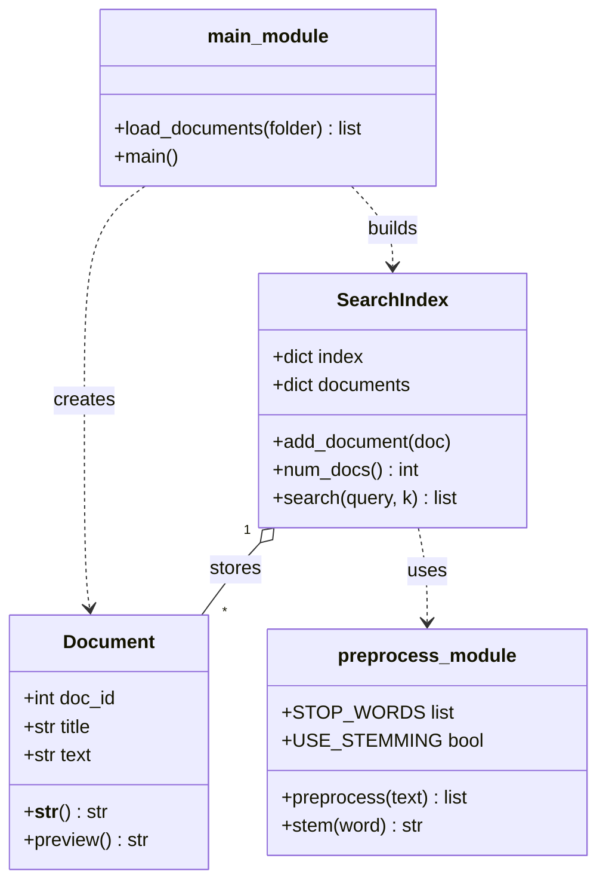
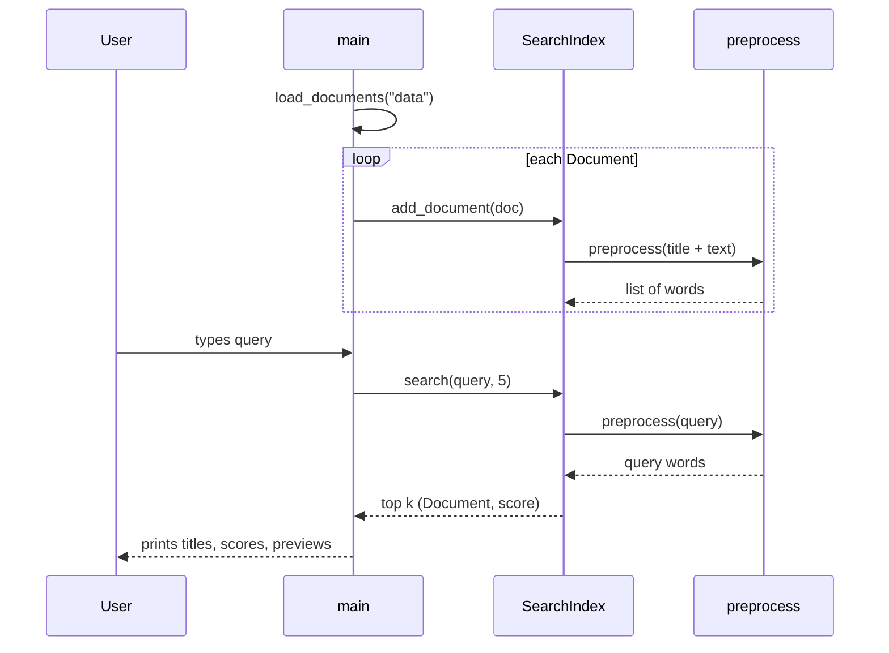

# Mini Search Engine – Project Idea and Design

## 1. Project idea
Mini Search Engine is a small keyword search engine written in Python. It loads a folder of short text documents (news-style articles), builds an index of every word in them, and lets the user type a search query in the terminal. It returns the top matching documents ranked by how relevant they are, kind of like a really small Google that only searches the files in the `data/` folder.

Goal: practice using the right data structures (dictionaries, sets, heaps) to make searching fast instead of reading every document for every query.

Example: typing `rain flooding` returns "Heavy Rain Causes Flooding In Several Towns" with a score of 5, because that is the only article that has both words.

## 2. Dataset
- I wrote 15 short news-style articles myself, stored as `data/doc1.txt` to `data/doc15.txt`.
- Format: the first line of each file is the headline (title), and the rest is the article body.
- Topics: sports, weather, tech, the city, running, cars, etc. Some articles share words on purpose (for example two basketball articles, three running articles) so ranking can be tested.
- Access: the files are included in the GitHub repo, so nothing needs to be downloaded. Anyone can add their own `.txt` files to `data/` and they get loaded automatically.
- Bigger optional dataset: the 20 Newsgroups dataset (http://qwone.com/~jason/20Newsgroups/), downloadable as a .tar.gz from that page, or a news headlines dataset from Kaggle. I did not use these, but the program would work with them if each article were saved as its own `.txt` file.

## 3. Software model / design

### Modules (packages) and classes
| File | Contains | Job |
|---|---|---|
| `document.py` | class `Document` | Holds one article |
| `preprocess.py` | `preprocess(text)`, `stem(word)`, `STOP_WORDS`, `USE_STEMMING` | Cleans text into a list of words |
| `search_index.py` | class `SearchIndex` | Builds the inverted index and runs searches |
| `main.py` | `load_documents(folder)`, `main()` | Loads files and runs the user search loop |
| `test_search.py` | class `TestSearch` | Unit tests |
| `compare.py` | script | Compares results with stemming on vs off |

### Classes and methods
**Document**
- Attributes: `doc_id` (int), `title` (str), `text` (str)
- `__str__()` returns "id: title"
- `preview()` returns the first 80 characters of the text

**SearchIndex**
- Attributes: `index` (dict: word -> {doc_id: count}), `documents` (dict: doc_id -> Document)
- `add_document(doc)` preprocesses title + text and adds each word to the index, counting how many times it appears
- `num_docs()` returns how many documents are loaded
- `search(query, k=5)` preprocesses the query, finds documents containing ALL query words (set intersection), scores each one (total count of query words), and returns the top k as (Document, score) pairs

**Functions**
- `preprocess(text)` lowercases, removes punctuation, splits into words, removes stop words, and stems each word (if `USE_STEMMING` is True)
- `stem(word)` cuts common endings (-ing, -ers, -er, -ed, -es, -s) and fixes double letters (running -> runn -> run)
- `load_documents(folder)` reads each `.txt` file and creates a `Document` (first line = title)
- `main()` builds the index and runs the search loop until the user types `quit`

### Class diagram

### How they interact
1. `main()` calls `load_documents("data")`, which reads each file and creates `Document` objects.
2. For each document, `main()` calls `index.add_document(doc)`, which calls `preprocess()` and updates the inverted index.
3. In the loop, the user types a query, and `main()` calls `index.search(query, 5)`.
4. `search()` calls `preprocess()` on the query (so it is cleaned the same way as the documents), looks up each word in the index, intersects the sets of doc ids, scores them, and uses a heap to get the top 5.
5. `main()` prints each result's title, score, and preview.

## 4. Libraries
All are part of Python's standard library, so nothing needs to be installed:
- `os` – lists and reads the files in the `data/` folder
- `string` – `string.punctuation`, used to remove punctuation
- `heapq` – `heapq.nlargest(k, scores)` to get the top k results
- `unittest` – for the test cases

## 5. Data structures
- **Dictionary (inverted index)** – the main structure. It maps each word to a dictionary of `{doc_id: count}`. Example: `"basketball" -> {7: 2, 8: 2}`. Looking up a word is O(1) on average, so search doesn't scan every document.
- **Dictionary (documents)** – maps `doc_id` to its `Document` object, so results can show titles.
- **Set** – for each query word, the set of doc ids that contain it. Set intersection (`&`) keeps only documents that contain all the words.
- **Heap (priority queue)** – `heapq.nlargest` picks the top k scores without sorting the whole list.
- **List** – stop words, the loaded documents, preprocessed words, and the result list.
- **Tuple** – `(score, doc_id)` pairs for ranking, and `(Document, score)` pairs as results.

## 6. Test cases (`test_search.py`)
The tests use a small index of three docs: 1 "My dog likes to run in the park", 2 "The cat sleeps all day on the couch", 3 "A dog and a cat can be friends. The dog is loud".

| # | Test | Input | Expected |
|---|---|---|---|
| 1 | Word in only one doc | `couch` | only doc 2 |
| 2 | Multi-word query needs all words | `dog cat` | only doc 3 |
| 3 | Case insensitive | `DOG` vs `dog` | same results |
| 4 | Unknown word | `elephant` | empty list, no crash |
| 5 | Empty / blank / only stop words | `""`, `"   "`, `the and` | empty list |
| 6 | Ranking by count | `dog` | doc 3 first (says dog twice) |
| 7 | k limits results | `dog`, k=1 | exactly 1 result |
| 8 | Preprocessing | `"Hello, World! The END."` | `["hello", "world", "end"]` |
| 9 | Stemming | `run` with docs "runner" and "running" | both docs returned |

Run them with `python3 test_search.py`. All 9 pass.

## 7. Expectations and weaknesses
I expect it to work well and fast for simple keyword searches on a small set of documents. The tests and sample searches (basketball, rain flooding, BATTERY, zebra) gave correct results.

Expected weaknesses:
- **Simple ranking:** score is just word count, so longer documents can win just for being long. TF-IDF would fix this.
- **All words required:** one extra word that isn't in a document makes it return nothing, instead of showing partial matches.
- **No spelling correction:** `basketbal` finds nothing.
- **Basic stemmer:** "battery" and "batteries" still don't match, and some words get cut oddly ("class" -> "clas"). A real stemmer like Porter (nltk) would be better.
- **Apostrophes:** "team's" becomes "teams".
- **No title boost:** title words count the same as body words.
- **Small dataset:** only 15 documents, so it hasn't been tested at a large scale.

Future improvements: TF-IDF ranking, extra weight for title words, partial matches when no document has every word, spelling correction, and testing on 20 Newsgroups.
